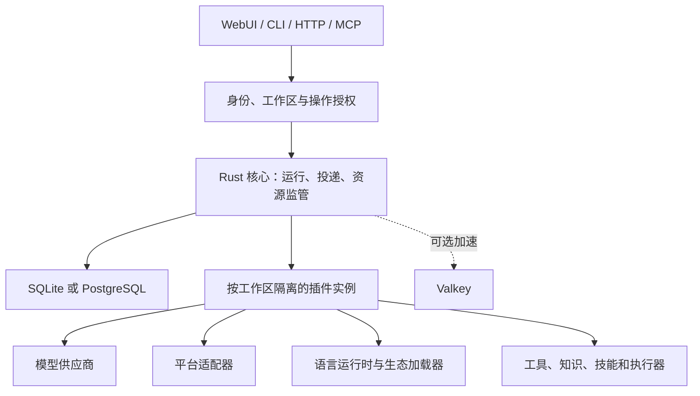

# RstrBot 产品与软件蓝图

设计版本 1.0 · 2026-10-28 · 状态：产品设计，尚未实现

## 一、产品承诺

用户应该能回答四个问题：机器人为什么回复、用了哪些数据、执行了哪些操作、最后是否送达。管理员应该能停止它、限制它、恢复它。开发者应该能只依赖公开协议完成扩展。

RstrBot 的差异重点是可控的日常运行：个人安装足够轻，团队使用有真实边界，第三方故障有清楚状态，复杂功能可以按需安装。Rust 是实现约束，不是对用户价值的替代说明。

本蓝图不承诺无限插件兼容、所有操作恰好执行一次、完全自动的安全恢复，或所有机器上相同的内存占用。这些要求受第三方协议、平台权限和硬件影响，必须落实为范围与证据。

## 二、用户与主要旅程

| 用户 | 一条完整旅程 | 成功结果 |
| --- | --- | --- |
| 个人使用者 | 安装桌面版，建立本地工作区，添加模型，开始聊天并安排提醒 | 不部署额外数据库服务也能完成；退出重开后记录和任务仍在 |
| 群聊维护者 | 接入一个平台，设置回复频率、管理员和知识库，观察群聊 | 不乱插话、不自我回声循环；主动消息发到正确群 |
| 团队管理员 | 选择 PostgreSQL，邀请成员，为不同项目分配模型与预算 | 成员、凭据、会话和数据各守边界；按工作区审计 |
| 普通成员 | 上传资料，提问，检查引用，纠正记忆，停止错误任务 | 不需要理解进程、队列或协议；能看懂结果与失败原因 |
| 插件开发者 | 选语言 SDK，声明入口与权限，在隔离环境试跑并发布包 | 不读核心内部实现也能完成插件；四种语言行为一致 |
| 外部应用开发者 | 通过受限 API/MCP 凭据调用聊天、查询和平台投递 | 入口不同但授权和业务结果一致；可恢复长任务状态 |

所有演示至少使用两个用户与两个工作区。只展示一个管理员账号无法证明多用户设计。

## 三、领域对象与所有权

| 对象 | 所有权和用途 | 必须避免的混淆 |
| --- | --- | --- |
| 用户 | 一个经过认证的人，可有多个登录方式 | 不等于平台昵称或机器人账号 |
| 工作区 | 一组成员、策略与资源的管理边界 | 不等于某个磁盘目录；也不意味着成员可读所有私聊 |
| 成员关系 | 用户在某工作区的角色与附加授权 | 角色不能被一个 API 请求临时伪造 |
| 服务身份 | 平台适配器、自动化和外部应用的调用主体 | 不继承安装者全部权限 |
| 会话 | 带参与者与可见范围的消息时间线 | 与平台投递地址、模型请求工作集分开 |
| 运行 | 一次已接受的用户意图或计划任务执行 | 取消、超时、模型结束、投递结束不是同一状态 |
| 工具操作 | 一项具体外部操作及参数、权限、回执 | 不能因重连被当成新的操作再做一遍 |
| 插件包 | 可验证的代码、版本、清单、SDK 协议 | 与某工作区的启用状态和配置分开 |
| 插件实例 | 某工作区中一份配置、权限和数据 | 不和别的工作区共享可变全局状态 |
| 附件/文档/记忆 | 有独立归属、来源、可见范围和保留期 | 路径不构成授权；模型记住不等于获得读取权限 |
| 投递路由 | 连接账号、平台会话及可用发送方式 | 逻辑会话重命名不改变授权收件人 |

稳定标识不能由显示名推导。删除、重建、重连和重新绑定必须有代次，旧回调不能影响新对象。保留复合归属校验，不能只靠“ID 足够随机”。

## 四、权限设计

### 4.1 默认角色

| 角色 | 默认能力 | 不默认拥有 |
| --- | --- | --- |
| 工作区所有者 | 成员、工作区策略、共享资源、导出与删除 | 其他工作区资源；宿主执行特权 |
| 管理员 | 机器人、模型连接、已获准插件实例与日常配置 | 转让所有权、读取个人密钥、全实例恢复 |
| 操作员 | 运行、诊断、停止、受限重试、日常任务管理 | 安装系统程序、授权新权限、查看私人会话 |
| 成员 | 自己的会话、获准代理/知识库、自己的任务 | 修改别人的资源和绕过工作区预算 |
| 查看者 | 获准只读页面与共享记录 | 发起调用、修改、导出敏感内容 |

实例管理员另有部署和容量权限。应用默认将私人内容访问与运维角色分开，紧急内容访问应明确授权并审计；无法对拥有主机管理员权限的人承诺密码学隔离，除非未来另行提供用户控制的加密方案。

有效权限是多个范围的交集：身份授权、工作区策略、资源可见性、插件能力、当前运行租约。角色或工具列表只能缩小这个集合。空白配置必须区分“继承”“明确禁止全部”“尚未配置”，不能把空集合当成全部允许。

API Key 不大于创建者授权，可限定工作区、操作、对象、有效期与用量。服务级共享凭据由核心代理使用；平台侧 OAuth、模型 OAuth 和面板登录分别管理。缓存失效或权限服务不可用时，不能继续使用无法确认的授权执行写入。

具体地，个人 key 每次使用取签发范围与所属用户当前权限的交集；离开工作区或降权立即缩小权限。服务身份的 key 取服务身份当前授权，创建者仅是审计字段，正式移交不依赖原管理员继续在职。供应商与平台组件优先使用限目标、用途和期限的凭据代理；确需处理签名或专有认证的受信任组件单独授权和隔离，秘密不能扩散到同语言运行时的其他插件。

### 4.2 重点边界

会话列表、全文搜索、知识库召回、向量索引、附件下载、缩略图、共享链接、日志、备份、通知、运行事件、插件 KV、任务枚举都必须受同一归属规则约束。授权之后再进行检索和聚合，避免结果数量、文件名或缓存命中泄露他人内容。

跨用户协作创建显式共享任务空间，只放被允许共享的摘要或材料；不拼接参与者全部私聊。群聊触发的 shell、文件和技能操作使用该运行的授权环境，不能借用群管理员的个人工作目录。

## 五、数据库和 Valkey 的确定方案

### 5.1 初始化选择

| 配置 | 适用范围 | 能力与限制 |
| --- | --- | --- |
| SQLite，无 Valkey | 默认桌面、小规模单实例服务 | 完整多用户语义；容量受磁盘与写并发影响 |
| SQLite，有 Valkey | 同一单实例加速 | 可减少重复读取；不能因此变成多节点写入数据库 |
| PostgreSQL，无 Valkey | 团队服务与更高并发 | 完整功能，持久通知/任务协调仍可工作 |
| PostgreSQL，有 Valkey | 同样功能的可选加速 | 缓存与通知优化；Valkey 失效不改变授权和任务事实 |

SQLite 可允许多个用户并发读取，写入仍需受控；WAL 不是无限并行写入，且其共享内存约束不适合把数据库放在任意网络文件系统。这些是存储实现需要尊重的边界。[SQLite 官方 WAL 说明](https://www.sqlite.org/wal.html)

PostgreSQL 使用独立迁移身份和最小权限运行身份。行级安全可作为额外防线，不能替代应用归属校验；表所有者、超级用户与绕过 RLS 的角色具有例外，连接池复用必须重置授权上下文。[PostgreSQL 行级安全](https://www.postgresql.org/docs/current/ddl-rowsecurity.html)

Valkey 的复制和故障切换不应成为业务完整性的唯一依据；本设计将数据库作为任务与权限事实来源。[Valkey 复制说明](https://valkey.io/topics/replication/)

### 5.2 可观察的存储行为

所有已确认接受的运行、任务认领、授权修改和工具意图必须先达到规定的持久化点。写入失败应拒绝新的危险操作或进入恢复状态。SQLite 默认选择保障已确认业务记录的耐久设置；可降低耐久的调优须明确说明断电损失窗口，不能作为默认性能成绩。

界面应区分连接池等待、数据库写入等待、业务查询耗时和外部服务耗时。记录 WAL 增长与检查点状态，告警给出具体原因；不自动删除数据库附属文件“修复”故障。

PostgreSQL 多副本需要持久任务认领和代次校验。失去租约后，核心拒绝该代次新申请的副作用；已进入外部发送阶段的操作仍可能完成，只能按在途或结果未知核对。需要目标侧 fencing、幂等或可靠撤销的强保证必须逐通道声明。插件直接调用第三方也受其已声明隔离与授权边界约束，不能仅凭本地租约宣称全局恰好一次。

完整备份使用暂停相关写入后的快照，或明确的已提交检查点与不可变资源清单，确保数据库引用与附件、索引和必要插件状态对应。无法导出的插件状态使备份标记不完整。恢复实例先进入核对模式，暂停计划任务、平台收发和外部副作用，检查意图与回执并确认连接身份后启用。

### 5.3 Valkey 失效策略

| 用途 | Valkey 失效时 | 禁止行为 |
| --- | --- | --- |
| 可重建查询缓存 | 回源数据库，限制并发与缓存击穿 | 读别的工作区旧缓存 |
| 在线状态/输入提示 | 显示未知或暂不可用 | 据此判定用户权限 |
| 实时通知 | 从持久事件恢复，显示重连状态 | 丢失任务完成记录 |
| 软节流 | 使用保守本地限速或受控降级 | 无界放量 |
| 硬预算、撤权、任务唯一认领 | 继续用数据库确认；无法确认则拒绝危险操作 | 把失败一律当允许 |

不得把 Valkey 地址写进每个插件。核心提供约定的缓存能力，插件使用带作用域的接口。加速服务的开启/关闭不应改变 API 的业务语义。

## 六、运行过程、消息和可靠性

运行分为接受、准备、执行、等待外部结果、收尾和终结。执行终态只有一次，之后可以补充投递/保存的核对结果，但不能悄悄再执行模型或工具。

| 事实维度 | 示例状态 | 用户可见含义 |
| --- | --- | --- |
| 生成 | 排队、生成中、完成、取消、失败、预算耗尽 | 是否得到回答 |
| 工具副作用 | 未开始、执行中、已确认、失败、结果未知 | 外部操作是否可能已经发生 |
| 投递 | 未发送、发送中、平台接受、失败、未知 | 消息是否送进目标渠道；平台接受不保证人已阅读 |
| 持久化 | 待保存、已保存、保存失败、恢复中 | 状态能否在重启后找到 |

开始执行前保存运行与操作意图；执行后保存可取得的真实回执。外部成功与本地保存之间不能做原子事务时，必须保留不确定状态和核对流程。已经发送的消息不能因终态数据库锁冲突而简单重发。

截止时间至少区分排队、工作进程执行、模型首段、流停顿、工具和持久化恢复。核心接收合法终止事件的时间可用于判断执行是否超时，但须先验证事件代次、序号、权限与结构。插件自报“已经完成”不是可信成功证明。

同一会话的状态修改串行或具备等效冲突控制；彼此独立的会话并行。提供每工作区配额和公平排队，防止一个群或插件占满全部资源。停止与运维控制拥有单独的受限控制通路，不被普通模型队列永久阻塞。

事件有稳定 ID、顺序、所属运行和恢复游标。重连不创建新运行，消费方可去重；游标过期给出重新同步指令。用户只收到仍有权访问的事件，缓存的订阅不能在撤权后继续泄漏内容。

## 七、插件与能力边界

图表示职责，不要求把每个框都做成独立微服务。默认一个核心进程及按需工作进程；拆分必须有故障、依赖或资源隔离理由。

核心保存权限、运行记录与资源配额；插件负责协议或能力实现。插件可以请求动作，核心重新检查授权。语言运行时不能授予自身更高权限，也不能获得所有工作区的原始密钥和数据库连接。

工作进程安全等级要公开：可信原生进程、受操作系统沙箱约束的进程、远程隔离服务。仅在单独进程运行不等于能阻止读取宿主文件。多用户部署的默认第三方执行环境必须达到所宣称的隔离等级；无法建立时拒绝启动或要求明确改用可信模式，不能静默退回宿主。

插件清单包含稳定身份、协议范围、语言入口、能力、依赖、配置描述、授权请求、支持平台、生命周期和迁移策略。下载/解压/安装分别限时、限大小、校验来源；路径穿越、符号链接和压缩炸弹不能写出目标。安装脚本与运行时具有不同信任边界，不能先执行代码再展示权限。

原生发现采用标准机制；Python 使用包入口点。旧目录约定由兼容加载器处理，避免混进新加载器形成永远维护的双重规则。SDK 与核心内部对象解耦；旧 LLM hook、工具循环、媒体和后台推送通过版本化兼容契约补齐并独立验收。

依赖准备、进程启动、协议握手和调用各有独立期限与状态。暂时错误有上限地退避，配置不变也可手动重试；永久错误不无限重启。启用不等于就绪。Runner 选择、工具、事件监听与命令分别声明能力和授权，不用一个扩展白名单混淆所有角色。

热重载先准备新实例、校验配置、准备能力，再切换可用代次；失败保留可用旧版本或清楚报告不可回滚原因。数据迁移不可逆时不能承诺代码回滚等于数据回滚。新版本要求更多权限时保持待授权，不自动沿用旧权限。

## 八、统一 API 与兼容设计

业务操作目录是各入口的共同来源。每项操作说明输入、结果、资源范围、权限、是否有副作用、是否幂等、可用入口、取消和恢复行为。HTTP 的路径或 MCP 的工具名只是投影。

| 操作类别 | 主要对象 | 特别要求 |
| --- | --- | --- |
| 身份与工作区 | 用户、成员、服务身份、授权 | 工作区上下文由认证入口建立 |
| 连接与能力 | 模型、平台、插件、运行时 | 区分支持/获准/在线，凭据不回显 |
| 对话与运行 | 会话、分支、运行、事件 | 稳定分页、流恢复、停止/重置分开 |
| 工具与投递 | 操作意图、回执、目标 | 防重复副作用，未知状态可核对 |
| 知识与文件 | 文档、索引、记忆、附件 | 授权在读取与召回之前，删除传播 |
| 运维与恢复 | 配置、任务、备份、升级 | 版本前置条件、长任务进度、可回退 |

旧 API 放在可选兼容服务中，不能穿透新的多用户边界。旧单用户数据导入时必须选择目标工作区和所有者。缺少归属的信息要求用户映射或隔离导入，不能自动公开。

兼容声明分“可以发现”“可以加载”“事件行为一致”“工具和媒体一致”“后台及恢复一致”五层。旧 HTTP 则按路由、方法、参数、认证、响应、流、错误和副作用逐项验证。所有未实现端点明确列出，不能把 501 换成空成功作为完成。

## 九、对话、上下文与费用

完整时间线只追加真实消息与操作事实；模型输入由受控投影生成。摘要保存覆盖的消息范围、生成模型、版本和过期条件。修改历史后使相关摘要失效，重新生成前保留可恢复来源，避免摘要持续引用已删除内容。

长期记忆独立于会话摘要，默认为经工作区策略许可的写入；用户可查看来源、纠错、删除和设置遗忘期限。对话中的指令不能自行授予记忆跨用户共享权。检索资料被视为内容，不自动升级为系统指令。

权重衰减、归档、停用和删除分别定义。重要记忆可固定，默认不因短期没有被召回而永久删除；恢复归档同步恢复人物页状态和获准检索资格。群聊、私聊及会话策略分别覆盖，已接收/已消费/已回答分开记录；自身发送回声默认不再次唤醒代理，但允许用户引用。

支持稳定提示前缀与按需资源展开，避免每轮重复注入全部插件说明。提供 token 来源拆解、压缩收益和检索贡献视图；不承诺所有模型通用精确 token 估算。可选快速决策模型在昂贵生成前处理群聊门控，失败策略不能强制无限回复。

模型请求、工具调用、重试与回退按独立尝试记录。已输出一部分的流与尚未输出的请求具有不同重试策略。失败不应把已经执行的工具从历史里抹掉；换模型必须形成合法的目标协议输入。

普通文本中的工具名不能触发执行。连续无进展、无效结构或相同结果重复尝试有独立纠错上限，提前终止并报告已经完成的部分和实际用量，不等待通用轮次全部耗尽。

费用与 token 上限分开。已知价格可预估、预留与结算；未知价格明确未知并可拒绝高风险请求。显示调用统计覆盖率，不能让取消、失败和缓存消耗从统计中消失。团队共享模型与个人模型按显式路由选择，不静默切换计费主体。

## 十、任务、知识库与媒体

计划任务应在创建时预览接下来若干触发时间，并显示时区。固定间隔不转成不等价的日历表达式。错过执行默认跳过并记录；用户可以对可安全补跑的任务选择合并补跑或有限次数补跑，副作用任务不无限追赶历史。

任务支持直接发送固定文本或执行一个代理，并可独立选择模型、工具与目标。执行前重新核对权限、预算和路由；多目标分别记录状态。跨用户收集信息要有任务关联，但回填范围由参与者授权。

知识库处理状态依次展示传输、解析、分块、向量化、索引发布和可检索。原文与展示片段保留定位关系；修改文档创建新代次，索引准备完成后原子切换。取消和失败只清理自身临时结果，不覆盖其他并发上传。

查询可以组合精确检索与语义检索，解释引用来自哪里。重排失效可返回已授权候选，但必须表明降级。更换嵌入模型导致维度变化时启动可恢复重建，不能混用旧新向量。外部知识后端是插件，须受同样的归属、超时、结果大小和引用规则约束。

所有媒体限制同时考虑压缩字节和解码后资源。远端内容按每次重定向及实际目标执行访问规则；不能将 HTTP 错误页保存成图片或音频。分块上传恢复先核对已收块，发布前校验总量与完整性；取消不污染已发布文件。

平台渲染应保留消息组件顺序、引用、转发、表情和文本。长文按平台能力合并、分段或附件发送，避免每个模型 token 都产生一次平台消息。语音失败提供可配置的文本兜底；文转图返回的“URL”必须是真正可授权读取的 URL，不能暗换成本机路径。

## 十一、部署、桌面和发布

默认安装不要求 Python、Node、.NET、Valkey 和外部向量数据库全部存在。需要某种插件时才安装该运行时，提供占用、版本、来源和卸载影响说明。核心与 Web 静态资产可独立发布，桌面复用同一受测后端。

桌面支持托盘/关闭行为设置、显式退出、日志导出、升级恢复及远程连接。重启不能留下幽灵工作进程。Unix socket 文件、Windows named pipe ACL 与服务用户隔离必须在对应系统实测；macOS 签名、权限与退出行为不能用 Linux 交叉编译代替。

网络版有反向代理、备份、恢复、数据迁移和离线安装指引。多副本只在 PostgreSQL、共享文件策略、任务租约、重复投递与故障恢复全部验收后启用；不默认部署一堆微服务。

发布产物必须能追溯到源码、依赖锁、CI 运行与测试清单。未签名预览与正式签名安装器分别标记；真实发布后才能声称已经有 Release。工具链更新不能悄悄取消旧支持平台。

## 十二、可测量目标

以下是首版工程目标，不是已测成绩。实现时固定硬件、数据、网络与统计方法，超标需要解释或重新评审，不能修改测试绕过。

| 项目 | 首轮目标与测量范围 |
| --- | --- |
| 低配核心 | Linux x86_64、1 vCPU/1 GiB、SQLite、无语言插件：启动稳定后空闲 RSS 目标不超过 64 MiB；另报系统总占用 |
| 轻量完整安装 | 一个 Python 插件、一个平台连接与远程模型：在 1 GiB 环境完成固定混合负载；报告峰值与 OOM，不能把插件内存排除后称“完整占用” |
| 控制响应 | 正常负载下停止请求核心接收 p95 目标不超过 250 ms；协作取消目标 2 s 内确认，外部不可撤销操作单独标明 |
| 压力与公平性 | 固定多工作区混合负载持续至少 60 分钟，报告排队、错误分类、队列上限和不同工作区公平性，不宣称固定通用吞吐 |
| 重启恢复 | 保存的任务、摘要、路由、插件配置和可恢复运行在受控重启后可核对；不把模型恰好复述正确当作恢复证据 |
| 前端 | 典型手机档位与受控网络下，主要文字和动作先可用；首屏不等待粒子、编辑器或图表；具体预算见前端设计 |
| 隔离 | 双工作区以及同工作区不同用户的私有会话，覆盖同名/相似 ID、并发、重连、撤权、日志和导出，未授权内容暴露为零，拒绝有证据 |

## 十三、实施顺序与退出条件

| 阶段 | 交付闭环 | 退出条件 |
| --- | --- | --- |
| A：身份与存储 | 初始化、两种数据库、用户/工作区、文件归属 | 四种数据库/Valkey组合的同一权限与恢复用例通过 |
| B：核心与插件 | 运行协议、插件生命周期、一个平台和模型、四语言 SDK | 进程故障不拖垮核心，撤权/取消/重载与协议测试通过 |
| C：日常工作 | 多轮工具、流、上下文、任务、知识、媒体 | 对话到投递再到重启恢复的完整链路可复现 |
| D：产品界面 | 新 WebUI、工作区管理、插件设置、诊断、粒子品牌页 | 手机/桌面/无动画/键盘使用完成真实任务 |
| E：生态迁移 | 旧插件/HTTP、OpenCode/Pi、数据导入与回滚 | 固定样本矩阵，有明确失败与版本边界 |
| F：发行 | 三平台桌面、服务器安装、CI、升级与灾备 | 原生测试和实际构建回执齐全，未验证内容单列 |

阶段可并行准备，但不能用后续页面演示替代前面隔离与完整性验收。新需求先更新 BUILD_PROMPT 和稳定需求编号，再决定实现；每轮保留旧版本归档，完成度来自证据而非代码体积。

## 十四、设计来源与边界

用户明确要求决定品牌、Rust、多用户、双数据库、可选 Valkey、粒子设计、插件扩展和设计交付。其余默认值与实施次序是本轮设计建议。研究来源、已关闭问题的实际含义及第一阶段完整追踪，见 RESEARCH_AND_DECISIONS.md、SOURCES.md 和 BOOTSTRAP_TRACEABILITY.md；不能把来源 issue 当成本项目已经复现的缺陷。
