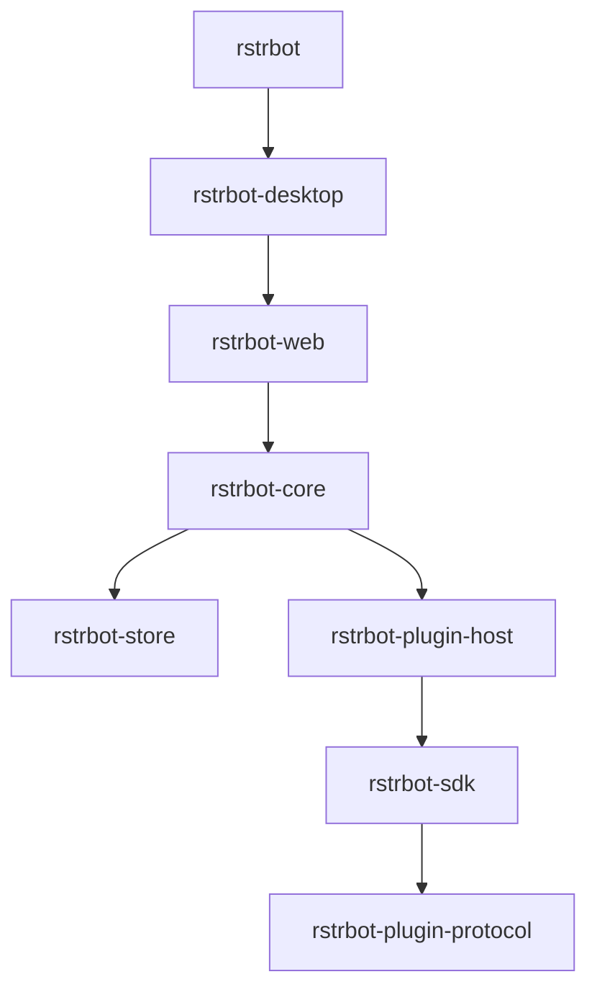

# 递归配方依赖

| 包 | 直接别名→包 | 产物/适用范围 | 集成入口 |
| --- | --- | --- | --- |
| rstrbot | desktop→rstrbot-desktop | 完整产品、文档、技能、追踪及平台交付组合 | 根ACCEPTANCE.md |
| rstrbot-desktop | client→rstrbot-web | 本地sidecar及远程模式；间接取得Web和核心 | 原生启动/退出、远程不启动本地服务 |
| rstrbot-web | service→rstrbot-core | 静态Web应用，API是开发和用户流程验收依赖 | 同源认证、真实业务和状态 |
| rstrbot-core | storage→rstrbot-store；plugins→rstrbot-plugin-host | CLI/HTTP、执行、调度、身份、知识和投递 | 双库、真实进程、故障恢复 |
| rstrbot-store | 无 | SQLite/PG共同持久语义 | ACL/CAS/预算/备份恢复 |
| rstrbot-plugin-host | sdk→rstrbot-sdk | 宿主、OpenAI/diagnostic/Webhook及MCP | 进程/网络/取消和回执 |
| rstrbot-sdk | protocol→rstrbot-plugin-protocol | 四语言SDK和共同样例 | 四进程一致性 |
| rstrbot-plugin-protocol | 无 | wire-format和声明式向量 | 独立协议验收 |

这是重建和集成依赖图，服务器无需运行桌面或Node，浏览器无需安装Rust。避免相同大接口材料在多个别名中重复展开：完整HTTP声明只放在core，其他包通过其递归依赖读取；协议只放在protocol。父包不能假设依赖的AGENTS.md变成全局规则。

每个source只指向本工作区真实的兄弟配方。pack会把依赖固定到各自.deps/<alias>/并生成根LOCK.md，归档可脱离这些作者路径校验/生成提示词。generated/中的实现、历史源码、系统/第三方库和外部账号/服务不是配方依赖；环境说明见ENVIRONMENT.md。
